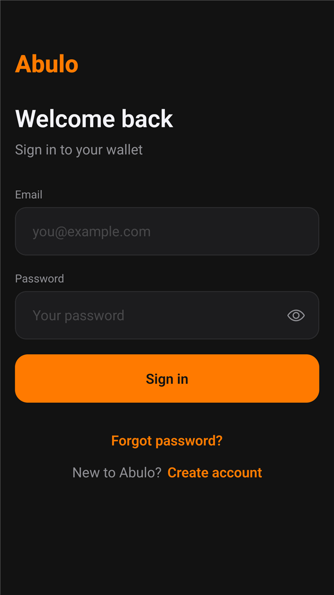

<div align="center">


# Abulo

**One wallet. Four marketplaces.**

Virtual numbers, verified accounts, gift cards and paid tasks — in one dark-mode app
for Android and the web.

[**Open the web app**](https://rapas11.github.io/abulo/app/) ·
[**Download the APK**](https://github.com/Rapas11/abulo/releases/download/v0.1.0/abulo-0.1.0.apk) ·
[**Project site**](https://rapas11.github.io/abulo/) ·
[**Documentation**](#running-locally)

<sub>Expo SDK 58 · React Native 0.88 · Supabase · TypeScript · Android + Web</sub>

</div>

---



## What it is

Abulo is a wallet-first marketplace app. Money lives in one balance; every purchase,
payout and fee is a ledger entry written by Postgres, never by the client. The same
code base ships as an Android APK and a static web app.

| Tab | What you can do |
|---|---|
| **Numbers** | Buy a virtual number for a service and country, read the SMS code in-app, get an automatic refund when no code arrives. |
| **Earn** | Post a paid task with a held reward, or complete a task and submit proof. Approval releases the money. |
| **Gift cards** | Submit a gift card at a published rate and watch it move from review to payout. |
| **Market** | Buy a verified account from a seller, or list your own. Sellers are paid from the buyer's order. |
| **Wallet** | Deposit, withdraw and audit every movement with a running balance. |
| **Profile → Admin** | The first account becomes admin: approvals, order lookup, markup and fee settings, demo-mode switch. |

<br clear="right" />

## Try it

**Web** — <https://rapas11.github.io/abulo/app/> (no install, works in any modern browser).

**Android** — [download `abulo-0.1.0.apk`](https://github.com/Rapas11/abulo/releases/download/v0.1.0/abulo-0.1.0.apk)
(26.7 MB) and open it. Android will ask you to allow installs from your browser the
first time. It is debug-signed, so Play Protect may show a warning — choose
“Install anyway”.

| | |
|---|---|
| Package | `com.abulo.app` |
| Version | `0.1.0` (versionCode 1) |
| ABIs | `arm64-v8a`, `armeabi-v7a` |
| Min Android | 7.0 |
| Signing | debug keystore — for testing only |

### Three minutes to a demo wallet

1. **Create an account** with any valid email. Email confirmation is off on the demo
   project, so there is no inbox step; set a 6-digit PIN and you are in.
2. **Deposit** from the wallet tab. Demo deposits credit the ledger instantly and take
   no real money.
3. **Buy something** — a number, a gift-card payout, a task reward or a marketplace
   listing. Every spend ends with a confirm sheet that repeats the exact amount.

Reopening the app asks for your PIN. That PIN is a local device lock (hashed in
AsyncStorage); the account itself lives in Supabase.

## Demo mode

The app is fully wired to a live Supabase project. What is **real**: accounts,
sessions, profiles, the wallet ledger, numbers orders, tasks, gift cards, marketplace
listings, seller payouts and the admin panel — all rows in Postgres, all money rules in
SQL functions.

What is **simulated** until provider keys are added:

| Flow | Current behaviour | Switch |
|---|---|---|
| Deposits / withdrawals | `deposit_demo` and `withdraw_money` move ledger money; no bank transfer | Paystack keys + webhook |
| SMS delivery | A code appears after ~9 seconds | 5sim API key |
| Gift-card checks | Auto-approved after ~20 seconds | Verifier integration |
| Listing review | Auto-approved after ~25 seconds | Manual review in admin |

Everything above is controlled by `settings.demo_mode`, toggleable from the admin
panel — the UI and database behave identically when real providers are plugged in.

## Money rules

All of these run inside `SECURITY DEFINER` SQL functions, so a modified client cannot
skip them:

- The balance **is** `sum(ledger.amount_kobo)` — there is no balance column to edit.
- Numbers are priced at provider cost × country multiplier × **40 % markup**.
- Marketplace purchases deduct a **7 % account fee** before the seller payout.
- Withdrawals cost a flat **₦50** and are rejected if balance < amount + fee.
- Task rewards are held when the task is posted and released only on approval.
- Direct inserts/updates on `ledger` are blocked by RLS for every client role.

## Running locally

```sh
git clone https://github.com/Rapas11/abulo.git
cd abulo/app
npm install
npx expo start          # Expo Go or an emulator
npx expo start --web    # browser at http://localhost:8081
```

A production web build:

```sh
cd app
npx expo export -p web --output-dir dist
node scripts/serve-dist.mjs        # http://localhost:4173
```

### Building the Android APK

The native project is generated on demand and is not committed:

```sh
cd app
npx expo prebuild -p android
cd android
./gradlew assembleRelease
# app/build/outputs/apk/release/app-release.apk
```

If the APK crashes on an emulator with `libreactnative.so` missing, set
`useLegacyPackaging = true` in `android/app/build.gradle` (the shipped APK uses it) and
rebuild.

## Repo layout

```
app/                 Expo app — Android + web
  src/app/           expo-router routes (tabs, auth, wallet, numbers, tasks, giftcards, market, admin)
  src/components/    shared UI (buttons, cards, sheets, inputs)
  src/lib/           Supabase client, money helpers, session + PIN storage
  src/theme.ts       design tokens: colours, type scale, radii, sizes
supabase/schema.sql  full schema: tables, RLS, money functions, seed data
site/                landing page source (published by GitHub Pages from docs/)
docs/                generated site: landing page + static web export in docs/app/
scripts/             site build and local static server
design/              HTML mockups of the original five screens
```

## Backend

The demo project is provisioned at
`https://wullpbyxutarkrmapxzx.supabase.co`; the publishable key is in
`app/src/lib/supabase.ts` and is safe to ship. To point the app at your own project,
set `EXPO_PUBLIC_SUPABASE_URL` and `EXPO_PUBLIC_SUPABASE_PUBLISHABLE_KEY`.

Fresh setup:

1. **SQL Editor →** paste `supabase/schema.sql` → **Run**.
2. **Authentication → Sign In / Providers → Email →** turn **off** “Confirm email”
   for instant sign-in, or keep it on and add `{{ .Token }}` to the “Confirm signup”
   template to use the in-app 6-digit screen.
3. Add `{{ .Token }}` to the “Reset password” template so password reset by code works.
4. First sign-up becomes admin (`profiles.role = 'admin'`).

## Deployment

`site/` is the hand-written landing page. `docs/` is what GitHub Pages publishes:
the landing page plus the Expo static export mounted at `/app/`.

```sh
SITE_BASE=/abulo \
SITE_URL=https://rapas11.github.io/abulo/ \
REPO_URL=https://github.com/Rapas11/abulo \
node scripts/build-site.mjs     # writes docs/
node scripts/serve-site.mjs     # preview at http://localhost:4173/abulo/
```

`scripts/serve-site.mjs` emulates the Pages subpath, so the preview matches production.
GitHub Pages serves the `docs/` folder on `main`; the export is path-prefixed
(`/abulo/app`), so the web app works from a project subpath. If the repository is
renamed, rebuild with the new `SITE_BASE` and push.

## Project status

- [x] Sprints 0–8 — foundation, auth, wallet, withdrawals, numbers, tasks, gift cards,
      accounts marketplace, admin panel
- [x] Web export, Android APK, landing page, Pages deployment
- [ ] Real Paystack keys (deposits, withdrawals, webhooks)
- [ ] Real 5sim key (SMS delivery)
- [ ] Release-signed APK / Play Store listing
- [ ] Web hydration warning cleanup (`Minified React error #418` on first paint)

## Notes and limits

- The APK is debug-signed. Treat it as a test build, not a store release.
- The Supabase publishable key is public by design; RLS and SQL functions enforce
  access. Never add a `service_role` key to the app.
- Demo money is not real money. Nothing in the current build touches a payment
  provider.

## License

MIT — see [app/LICENSE](app/LICENSE).
